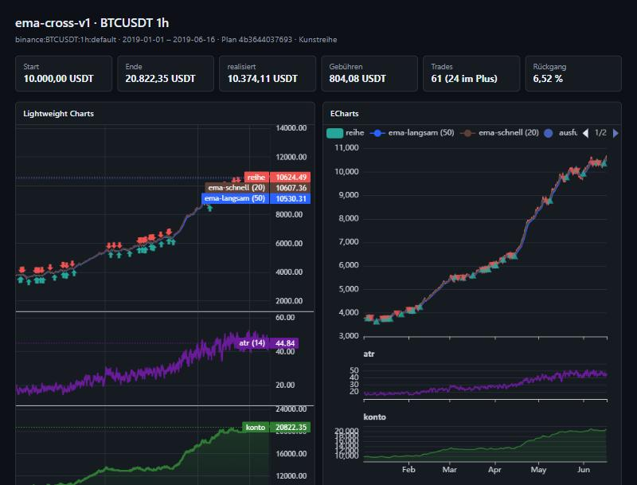

# nw-predictor

[](https://github.com/Netdoc64/nw-predictor/actions/workflows/ci.yml)
[](LICENSE)
[](package.json)

Registry-getriebener Trading-Predictor: die Rechenwege stehen nicht im Code,
sondern in einer Registry — vertikal (was baut worauf auf), horizontal (für
welche Märkte) und strategisch (welche Haltung). Eine Zustandsmaschine je Markt
fährt den Lebenszyklus; dieselbe Maschine mit einem `replay`-Feed **ist** die
Simulation.

Der Unterschied zu einem gewöhnlichen Backtester steckt in drei Zusagen, die
der Code einhält und die Tests bewachen:

| Zusage | Was sie verhindert |
| --- | --- |
| **Replay ≡ Live** | Derselbe Datensatz, einmal am Stück und einmal Bar für Bar, ergibt dasselbe. Fällt dieser Test, gibt es Look-ahead-Bias — und jede Backtest-Zahl ist wertlos. |
| **Jede Entscheidung trägt ihre Rechenkette** | Zu jedem Fill lässt sich zurückverfolgen, aus welchen Werten er entstand, bis zur Rohbar. Eine Gewinnzahl ohne diesen Weg ist eine Behauptung. |
| **Geld ist Festkomma, nie Fließkomma** | Die Summe aller Belege muss den Kontostand ergeben — geprüft nach jedem einzelnen Fill, nicht am Ende. |

**Kein Weg zu einer Börse.** Keine Orderausführung, keine Anlageberatung — das
ist eine Architekturentscheidung, kein fehlender Schalter ([PLAN.md](PLAN.md)
§13).

> **In English:** a registry-driven trading predictor. Calculation paths live in
> a registry rather than in code; the same state machine that runs live also
> runs the simulation, which is what makes replay and live provably identical.
> It never places orders. Documentation, comments and tests are in German.

**Der Bauplan steht in [PLAN.md](PLAN.md)** — Architektur, jede Entscheidung mit
ihrem Rückweg, und ein Register von 170 Kanten, an denen so ein System still
falsch rechnen kann. Diese Datei sagt nur, wie man es startet und was heute
wirklich läuft.

## Schnellstart

```bash
pnpm install
pnpm test
node --experimental-strip-types scripts/erstlauf.ts    # vier Strategien, ein Vergleich
node --experimental-strip-types scripts/chart.ts       # eine HTML-Datei, zwei Chart-Bibliotheken
```

<details>
<summary>PowerShell</summary>

```powershell
pnpm install
pnpm test
node --experimental-strip-types scripts/erstlauf.ts
```

</details>

Node 24 oder neuer, pnpm 8. Ohne Marktdaten rechnet der erste Lauf mit einer
reproduzierbaren Kunstreihe und sagt das im Kopf jeder Ausgabe.

**Mitwirken:** [CONTRIBUTING.md](CONTRIBUTING.md) ·
**Sicherheitsproblem:** [SECURITY.md](SECURITY.md) ·
**Umgangston:** [CODE_OF_CONDUCT.md](CODE_OF_CONDUCT.md)

## Was heute läuft

| Meilenstein | Stand | Was davon steht |
| --- | --- | --- |
| M0 Gerüst | **fertig** | `core-ids` (Adressen, Festkomma, Kanonisierung), `errors` (Codes, Budgets, Redaktion) |
| M1 Werkzeug-Anschluss | **fertig** | beide Bündel angekommen, Map-Workflow grün, Saat trägt eigene Belege |
| M2 Registry vertikal | **fertig** | Definitionen, `resolve()` rein und getestet, Ordnungszahl-Regel, Zyklusprüfung |
| M3 Registry horizontal | **teil** | Scope-Matrix als Typ, atomares Schreiben + Fremdschreiber-Erkennung; Lease fehlt |
| M4 Feeds | **fertig für den ersten Lauf** | Normalisierung (Duplikate, Lücken, Unplausibles, Zukunft), Binance-REST, Kunstreihe |
| M5 Maschine | **fertig** | 8 Zustände, Journal mit `vorhaben`/`vollzogen`, Warmup-Guard, **Replay ≡ Live grün** |
| M6 Chart | **fertig** | Registry-Bindung (`darstellung` an der Definition), Lightweight- und ECharts-Treiber, Konformitätssuite gegen drei Treiber, Sichtprobe im Browser |
| M7 MCP lesend | **fertig** | stdio-Server, 15 lesende Werkzeuge, Paginierung, Byte-Grenze, Altersangabe der Code-Karte |
| M8 Modelle | offen | |
| M9 Simulation | **fertig für den ersten Lauf** | Szenario, zwei Hashes, Belege, Rechenband, Bericht |
| M10 MCP schreibend | offen | braucht laufende Live-Maschinen |
| M11 Flächen + Strategievergleich | **fertig** | Flächen als Registry-Einträge, gebundene Flächen je Strategie, Vergleich auf vier Ebenen über das Protokoll |

197 Tests (113 eigene, 84 aus dem Autoupdate-Bündel), `tsc --noEmit` sauber.

## Der erste Lauf

Echte Daten holen (öffentliche Binance-Kerzen, kein Schlüssel nötig):

```powershell
node --experimental-strip-types scripts/hole-daten.ts BTCUSDT 2019-01-01T00:00:00Z 2019-07-01T00:00:00Z
```

Danach liest der Erstlauf `daten/binance-BTCUSDT-1h.ndjson`. Fehlt die Datei,
rechnet er mit einer reproduzierbaren Kunstreihe (Saat 7) und sagt das im Kopf
jeder Ausgabe — **diese Zahlen beschreiben dann die Maschine, nicht den Markt.**

### Ergebnis auf echten Daten

BTCUSDT 1h, 2019-01-01 bis 2019-07-01, 4.329 Bars, Startkapital 10.000 USDT,
Binance-Spot-Taker-Gebühren (10 bp) plus 1 bp Spread und 1 bp Slippage:

| Strategie | Ende | Trades | Gebühren | Rückgang |
| --- | ---: | ---: | ---: | ---: |
| `null-v1` | 10.000,00 USDT | 0 | 0,00 USDT | 0,00 % |
| `buyhold-v1` | 29.919,56 USDT | 1 | 9,98 USDT | 22,27 % |
| `ema-cross-v1` | 14.801,08 USDT | 74 | 597,75 USDT | 15,35 % |
| `ema-cross-v2` | 14.961,33 USDT | 74 | 600,79 USDT | 15,32 % |

Beide Kreuzungs-Strategien liegen rund 15.000 USDT **unter** Kaufen-und-Halten —
in einem Halbjahr, in dem Bitcoin sich verdreifacht hat, ist das die erwartete
Antwort. Dass sie dabei 600 USDT Gebühren verbrennen, ist der Punkt: ohne
Kostenmodell hätte es anders ausgesehen.

Die Normalisierung meldet zwei Lücken in Binances eigener Historie. Sie werden
gezählt, nicht gefüllt.

### Die vier Strategien

Keine davon ist zum Geldverdienen gedacht — sie sind eine Leiter (PLAN.md §16.4):

| # | Strategie | Was sie beweist |
| --- | --- | --- |
| 1 | `null-v1` | ohne Entscheidung passiert **exakt** nichts: 0,00, keine Gebühr |
| 2 | `buyhold-v1` | Positionsführung über Jahre — und die Messlatte |
| 3 | `ema-cross-v1` | die erste vollständige Kette, von Hand nachrechenbar |
| 4 | `ema-cross-v2` | wortgleich, nur ATR(10) statt ATR(14) — das Vergleichspaar |

Sprosse 4 prüft das Vergleichswerkzeug gegen eine bekannte Antwort. Findet die
Zuordnung den ATR-Knoten nicht, ist nicht die Strategie kaputt, sondern der
Vergleich. Er findet ihn:

```
── 4 · Zuordnung ───────────────────────────────────────────
  Knoten "atr" ist in beiden Strategien verschieden parametriert
    2019-01-05T02:00:00.000Z  A=3100065347  B=3188280165
```

## Chart

```bash
node --experimental-strip-types scripts/chart.ts ema-cross-v1
```



Schreibt `laeufe/ema-cross-v1/chart.html`: eine Datei, beide Bibliotheken
eingebettet, kein Netz nötig. Links Lightweight Charts, rechts ECharts — aus
**demselben** Op-Strom.

Das Bild zeigt den Lauf auf der **Kunstreihe**, nicht auf echten Kursen — ohne
Marktdaten rechnet das Projekt mit einer reproduzierbaren Reihe und schreibt das
in den Kopf jeder Ausgabe. Ein Bild, das so tut, als wären es echte Kurse, wäre
genau der stille Fehler, gegen den dieses Projekt gebaut ist.

Die Layer kommen aus der Registry. Jede Definition sagt per `darstellung`, wie
ihr Ausgang aussieht (`candles`/`line`/`area`/`markers`, Preisfenster oder
eigenes Fenster); `chart-bindung` liest das. Ein neuer Indikator mit
`darstellung` erscheint im Chart, ohne eine Zeile Chart-Code.

`window.__VP_RUECKSCHAU__` in der Seite zeigt, was jede Bibliothek wirklich
hält. Auf den echten BTCUSDT-Daten sind beide identisch — das war nicht von
Anfang an so, siehe PLAN.md §14.

## MCP — mehrere Flächen

Die Flächen stehen in [`registry/flaechen.json`](registry/flaechen.json) und
sind in [`.mcp.json`](.mcp.json) für Claude Code eingetragen. Startet Claude in
diesem Verzeichnis, fragt es beim ersten Mal, ob es die drei Server zulassen
soll.

| Fläche | gebunden an | Werkzeuge | Was sie kann |
| --- | --- | ---: | --- |
| `vp-wurzel` | — | 15 | listet die Flächen, vergleicht Strategien auf vier Ebenen, fragt die Code-Karte |
| `vp-ema-cross-v1` | `ema-cross-v1` | 10 | rechnet, liest Belege und Rechenketten — **nur dieser** Strategie |
| `vp-ema-cross-v2` | `ema-cross-v2` | 10 | dasselbe für v2 |

Eine gebundene Fläche hat das Vergleichswerkzeug **nicht** — es wird gar nicht
registriert. Fragt man sie nach der fremden Strategie, verweigert sie mit
Verweis auf die Wurzel. Jede Fläche hat ein eigenes Simulationsbudget je Stunde
und eine Obergrenze für die Antwortgröße.

Von Hand, zum Ausprobieren:

```powershell
node --experimental-strip-types scripts/mcp.ts --flaeche wurzel
```

Alle Werkzeuge sind lesend. Es gibt kein Order-Werkzeug und keine Empfehlung —
das ist eine Architekturentscheidung (PLAN.md §13), kein fehlender Schalter.

## Die Regeln, die der Code durchhält

| Regel | Wo sie verankert ist |
| --- | --- |
| Kein Fließkomma für Preise, Mengen, Geld | `core-ids/zahlen.ts`, Festkomma mit 8 Stellen |
| Geld-Invariante nach **jedem** Fill | `trading/konto.ts`, `VP-TRADE-0004` ist `fatal` |
| Fill frühestens zur Öffnung der **nächsten** Bar | `trading/knoten.ts` |
| Replay ≡ Live | `tests/erstlauf.test.ts`, Pflichttest |
| Warmup aus den **Parametern**, nicht aus dem Default | `registry/typen.ts` |
| Jede Entscheidung trägt ihre Rechenkette | `trace/`, `Beleg.kette` |
| Konsument deklariert das Schema, das er liest | `registry/resolve.ts`, §12/C30 |
| Vergleich nur bei gleichem Prüfstand | `sim/vergleich.ts`, verweigert statt warnt |
| Keine Orderausführung, keine Anlageberatung | PLAN.md §13 — architektonisch, nicht als Schalter |

## Lizenz und Haftung

Apache-Lizenz 2.0 — siehe [LICENSE](LICENSE). [NOTICE](NOTICE) nennt, was in
einer **erzeugten** Chart-Datei mitwandert: sie bettet TradingView Lightweight
Charts™ und Apache ECharts im Volltext ein, beide Apache-2.0, und trägt deren
Hinweise selbst im Kopf.

Kursdaten stehen **nicht** unter dieser Lizenz. Sie liegen nicht im Repo
(`daten/` ist gitignoriert), gehören dem jeweiligen Handelsplatz, und dessen
Bedingungen gelten auch für die Weitergabe.

**Haftungsausschluss.** Dies ist Simulationssoftware. Sie rechnet Fills gegen
ein Modell und hat keinen Weg zu einer Börse — keine Orderausführung, keine
Anlageberatung, keine Empfehlung (PLAN.md §13). Ergebnisse aus Simulationen
sagen nichts über künftige Erträge; sie beschreiben, was ein Modell auf
vergangenen Daten getan hätte. Die Software wird „wie besehen" bereitgestellt,
ohne Gewähr — die Einzelheiten stehen in Abschnitt 7 und 8 der Lizenz.

## Geheimnisse

Venue-Schlüssel kommen aus einem externen Schlüsselspeicher, nie aus einer Datei
in diesem Repo. Der erste Lauf braucht keine: die Binance-Kerzen sind öffentlich.
